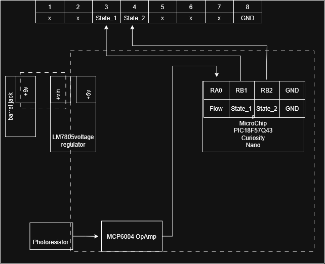

## Overview
The following block diagram describes the flow sensing subsystem I was responsible for. The board's purpose is to provide a status of whether or not water is flowing through the system. This device runs solely on +5v dc stepped down from +9v dc using a regulator. This board makes use of a photoresistor to detect whether or not water is flowing through a transparent tube. The photoresistor is connected to a circuit that drives an OpAmp chip where the output is eventually amplified and taken to the input on the PIC Curiosity Nano. My board is a "slave" board that communicates with the "master" board. This board exclusively outputs. The outputs consist of two wires that can be pulled high or low by the PIC totalling to 4 output states.

## Flow-Sensing Module Block Diagram 
