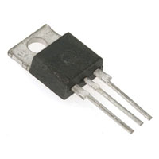

Here is informaiton regarding the rationale for selecting the components that will be put in my subsystem board. 

*Table 1: Flow Sensing Resistor*

**Photoresistor**

| **Solution**                                                                                                                                                                                      | **Pros**                                                                                                                                    | **Cons**                                                                                            |
| ------------------------------------------------------------------------------------------------------------------------------------------------------------------------------------------------- | ------------------------------------------------------------------------------------------------------------------------------------------- | --------------------------------------------------------------------------------------------------- |
| .webp) Option 1.  PDV-P8103 Photoresistor  $0.77/each [link to product](https://www.digikey.com/en/products/detail/advanced-photonix/PDV-P8103/480610)                 | \* Inexpensive \* Accepts 5 Volts  \* Rated resistance rate is desirable                                               | \* Might Have trouble getting to work with resistive amp  |
|  \* Option 2.  \* NORPS-12 Photoresistor  \* $2.46/each  \* [Link to product](https://www.digikey.com/en/products/detail/advanced-photonix/NORPS-12/5039796) | \* Reliable  \* Two-leaded package  | \* More expensive                                                        |
|  \* Option 3.  \* NSL-5110 Photoresistor  \* $3.19/each  \* [Link to product](https://www.digikey.com/en/products/detail/advanced-photonix/NSL-5110/5039795) | \* Resistance Values are desriable  \* Wide operating temperature  | \* Most Expensive                                                       |

**Choice:** Option 1: PDV-P8103 Photoresistor

**Rationale:** This photo sensor has desirable resistance values for the application. It is also the least expensive option on digikey, since cost is a concern for this project.  

 

 *Table 2: DC Linear Regulator Component Selection*

**DC Linear Regulator**

| **Solution**                                                                                                                                                                                      | **Pros**                                                                                                                                    | **Cons**                                                                                            |
| ------------------------------------------------------------------------------------------------------------------------------------------------------------------------------------------------- | ------------------------------------------------------------------------------------------------------------------------------------------- | --------------------------------------------------------------------------------------------------- |
|  Option 1.  Toshiba SSM3J36FS P-Channel Mosfet  $2.25/each [link to product](https://www.jameco.com/z/LM7805CT-National-Semiconductor-IC-LM7805CT-5V-1A-Positive-Voltage-Regulator-40C-125C-Temp-_786138.html)                 | \* Voltage is desirable                                               | \* Not as effecient |
|  \* Option 2.  \* LM7905 Linear Regulator  \* $1.72/each  \* [Link to product](https://www.digikey.com/en/products/detail/texas-instruments/LM7905CT-NOPB/6349) | \* 5v regulator  \* No external components to set voltage   | \* Negative output                    |
| .webp) \* Option 3. MC78M05BDTRKG Linear Regulator \*   \* $0.47/each  \* [Link to product](https://www.digikey.com/en/products/detail/toshiba-semiconductor-and-storage/T2N7002AK-LM/5298028) | \* Least Expensive  \* Output voltage is fixed  | \* Surface Mount Design                                                      |

**Choice:** Option 1: LM7805 Linear Regulator

**Rationale:** This liner regulator is a through-hole design and doesn't need external circuitry (except conditioning capicitors) to output 5v DC. 

## Power Budget 

