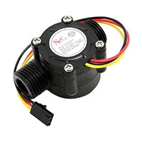
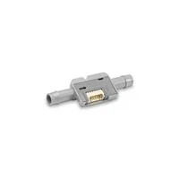

Here is informaiton regarding the rationale for selecting the components that will be put in my subsystem board. 

*Table 1: Flow Sensor component selection*

**Flow Sensor**

| **Solution**                                                                                                                                                                                      | **Pros**                                                                                                                                    | **Cons**                                                                                            |
| ------------------------------------------------------------------------------------------------------------------------------------------------------------------------------------------------- | ------------------------------------------------------------------------------------------------------------------------------------------- | --------------------------------------------------------------------------------------------------- |
|  Option 1.  314150005 Flow Sensor  $9.50/each [link to product](https://www.digikey.com/en/products/detail/seeed-technology-co-ltd/314150005/5488047)                 | \* Inexpensive \* Accepts 5 Volts  \* Rated flow rate is desirable                                               | \* Requires MOSFET to interact with PIC  \* Connectors require 1/2 inch piping |
|  \* Option 2.  \* SLF3S-4000B Liquid Flow Sensor  \* $191.87/each  \* [Link to product](https://www.digikey.com/en/products/detail/sensirion-ag/SLF3S-4000B-LIQUID-FLOW-SENSOR/16579752) | \* Extremely Accurate  \* Communicates with I2C  | \* Very expensive  \* Flow might be too small                                                        |
| .jpg) \* Option 2.  \* SEN0216 Liquid Flow Sensor  \* $8.90/each  \* [Link to product](https://www.digikey.com/en/products/detail/dfrobot/SEN0216/6579445) | \* Rated flow rate is desirable  \* Uses small 6mm ID piping  | \* Might not be as accurate                                                       |

**Choice:** Option 3: SEN0216 Liquid Flow Sensor

**Rationale:** This device uses a small ID tube which is better since we want to precisely control the amount we want to dispense. 

 

 *Table 2: Flow Sensor component selection*

**External Clock Module**

| **Solution**                                                                                                                                                                                      | **Pros**                                                                                                                                    | **Cons**                                                                                            |
| ------------------------------------------------------------------------------------------------------------------------------------------------------------------------------------------------- | ------------------------------------------------------------------------------------------------------------------------------------------- | --------------------------------------------------------------------------------------------------- |
|  Option 1.  314150005 Flow Sensor  $9.50/each [link to product](https://www.digikey.com/en/products/detail/seeed-technology-co-ltd/314150005/5488047)                 | \* Inexpensive \* Accepts 5 Volts  \* Rated flow rate is desirable                                               | \* Requires MOSFET to interact with PIC  \* Connectors require 1/2 inch piping |
|  \* Option 2.  \* SLF3S-4000B Liquid Flow Sensor  \* $191.87/each  \* [Link to product](https://www.digikey.com/en/products/detail/sensirion-ag/SLF3S-4000B-LIQUID-FLOW-SENSOR/16579752) | \* Extremely Accurate  \* Communicates with I2C   \* Uses 6mm ID tubing| * Very expensive  \* flow rate might be too slow                                                        |

**Choice:** Option 2: CTX936TR-ND surface mount oscillator

**Rationale:** A clock oscillator is easier to work with because it requires no external circuitry in order to interface with the PSoC. This is particularly important because we are not sure of the electrical characteristics of the PCB, which could affect the oscillation of a crystal. While the shipping speed is slow, according to the website if we order this week it will arrive within 3 weeks.