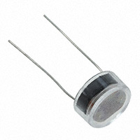
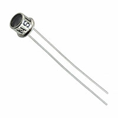

Here is informaiton regarding the rationale for selecting the components that will be put in my subsystem board. 

*Table 1: Flow Sensor component selection*

**Flow Sensor**

| **Solution**                                                                                                                                                                                      | **Pros**                                                                                                                                    | **Cons**                                                                                            |
| ------------------------------------------------------------------------------------------------------------------------------------------------------------------------------------------------- | ------------------------------------------------------------------------------------------------------------------------------------------- | --------------------------------------------------------------------------------------------------- |
| .webp) Option 1.  PDV-P8103 Photoresistor  $0.77/each [link to product](https://www.digikey.com/en/products/detail/advanced-photonix/PDV-P8103/480610)                 | \* Inexpensive \* Accepts 5 Volts  \* Rated resistance rate is desirable                                               | \* Might Have trouble getting to work with resistive amp  |
|  \* Option 2.  \* NORPS-12 Photoresistor  \* $2.46/each  \* [Link to product](https://www.digikey.com/en/products/detail/advanced-photonix/NORPS-12/5039796) | \* Reliable  \* Two-leaded package  | \* More expensive                                                        |
|  \* Option 3.  \* NSL-5110 Photoresistor  \* $3.19/each  \* [Link to product](https://www.digikey.com/en/products/detail/advanced-photonix/NSL-5110/5039795) | \* Resistance Values are desriable  \* Wide operating temperature  | \* Most Expensive                                                       |

**Choice:** Option 1: PDV-P8103 Photoresistor

**Rationale:** This photo sensor has desirable resistance values for the application. It is also the least expensive option on digikey, since cost is a concern for this project.  

 

 *Table 2: Flow Sensor Switching Mosfet component selection*

**Switching Mosfet**

| **Solution**                                                                                                                                                                                      | **Pros**                                                                                                                                    | **Cons**                                                                                            |
| ------------------------------------------------------------------------------------------------------------------------------------------------------------------------------------------------- | ------------------------------------------------------------------------------------------------------------------------------------------- | --------------------------------------------------------------------------------------------------- |
| .webp) Option 1.  Toshiba SSM3J36FS P-Channel Mosfet  $0.27/each [link to product](https://www.digikey.com/en/products/detail/toshiba-semiconductor-and-storage/SSM3J36FS-LF/2071880)                 | \* Voltage is desirable                                               | \* Requires a negative supply voltage |
| .webp) \* Option 2.  \* Nexperia 2N7002NXAKR N-Channel Mosfet  \* $0.14/each  \* [Link to product](https://www.digikey.com/en/products/detail/nexperia-usa-inc/2N7002NXAKR/10416554) | \* N-Channel mosfet  \* Inexpensive   | \* Heat sensitive                     |
| .webp) \* Option 3. Toshiba T2N7002AK N-Channel Mosfet  \*   \* $0.17/each  \* [Link to product](https://www.digikey.com/en/products/detail/toshiba-semiconductor-and-storage/T2N7002AK-LM/5298028) | \* Reputable manufacturer  \* Tried and true design  | \* More expensive                                                      |

**Choice:** Option 2: Nexperia 2N7002NXAKR N-Channel Mosfet

**Rationale:** This mosfet is best since it works within the limits of my proposed design as well as the price. 

## Power Budget 

