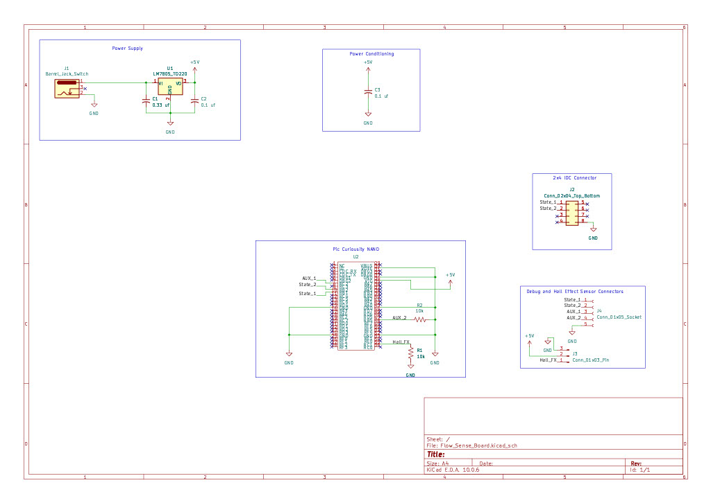

## Overview

This schematic was designed to interpret and send speed data from a hall-effect flow sensor.

{style width:"350" height:"300;"}
**Figure 1:** Showing the current working schematic.

## Resouces

The schematic as a PDF download is available [*here*](Flow_Sense_Board.pdf), and the Zip folder of the project [*here*](Flow_Sense_Board.zip).