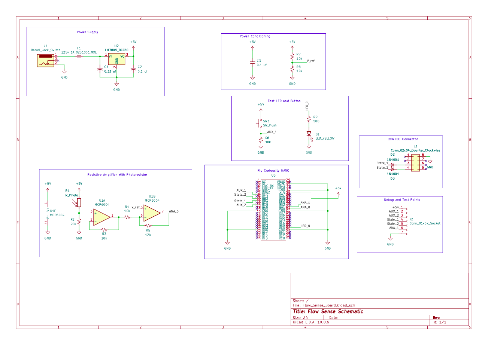

## Overview

This schematic was designed to detect liquid flowing through a transparent tube using a light sensor. When liquid flows through the tube, the light sensor will experience less light and increase its resistance. This will cause less voltage to get to the buffer and thus less voltage to reach the inverting amplifier. The PIC will notice the drop in voltage and understand that there is liquid flowing. It will then change its output state to the pre-determined state to tell the master unit that liquid is flowing. 

{style width:"350" height:"300;"}
**Figure 1:** Showing the current working schematic.

## Resouces

The schematic as a PDF download is available [*here*](Flow_Sense_Board_118.pdf), and the Zip folder of the project [*here*](FLOW_SENSE_BOARD_11_8.zip).