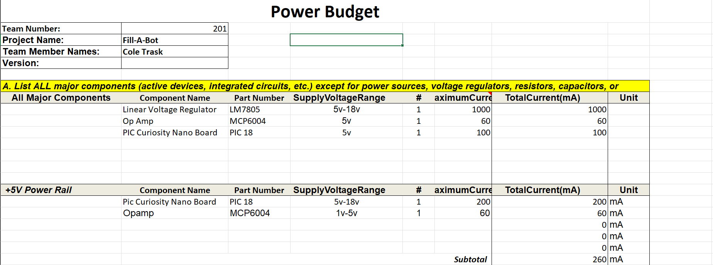
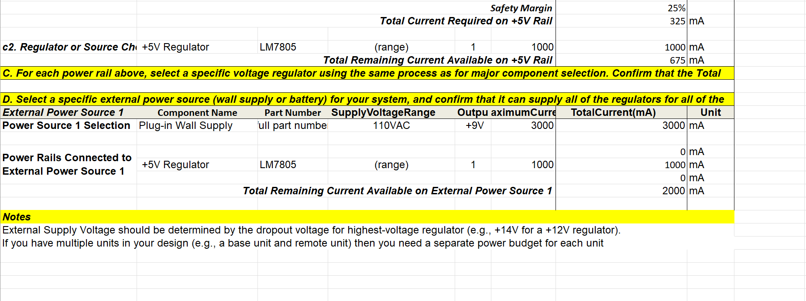

## Overview
When designing this circuit, I had to research the power needs of each of my major components. I ended up getting the estimations below.

{style width:"350" height:"300;"}

{style width:"350" height:"300;"}

## Conclusions

From these calculations, I can confidently say that my power supply and voltage regulator will provide sufficient power for my board. 

## Resouces

The power budget as a PDF download is available [*here*](PowerBudgetffinal.pdf), and a Microsoft Excel Sheet [*here*](PowerBudgetffinal.xlsx).