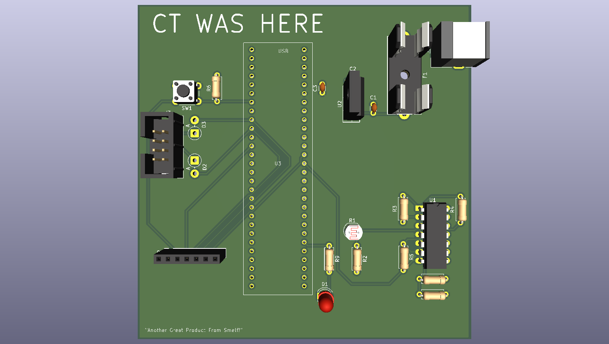
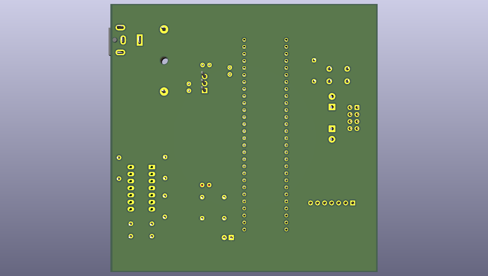

# PCB Design

## Pictures

{style width:"350" height:"300;"}
*front view of the current PCB design*

{style width:"350" height:"300;"}
*rear view of the current PCB design*u

## Discussion

## Resources

A zip file of the current project containing the necessary Gerber Files can be downloaded [here](Flow_Sense_Board_Manufacture_Final.zip). The KiCad Files can be found [here](FLOW_SENSE_BOARD_11_8.zip)